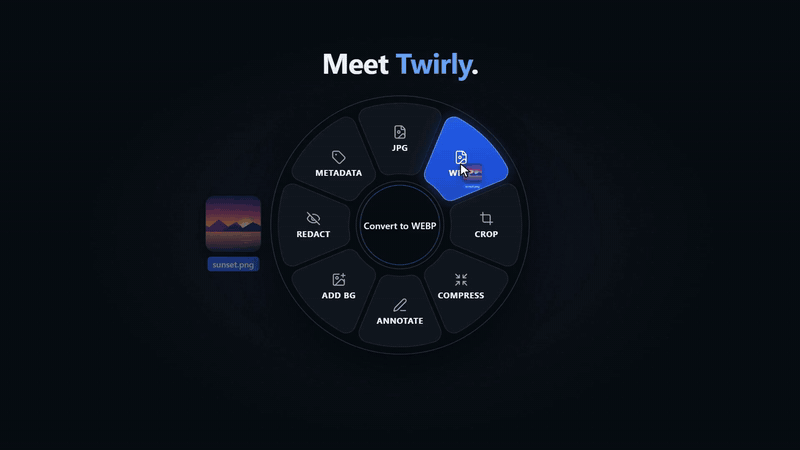
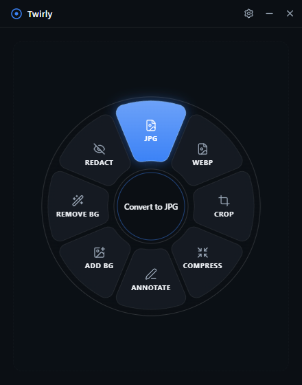
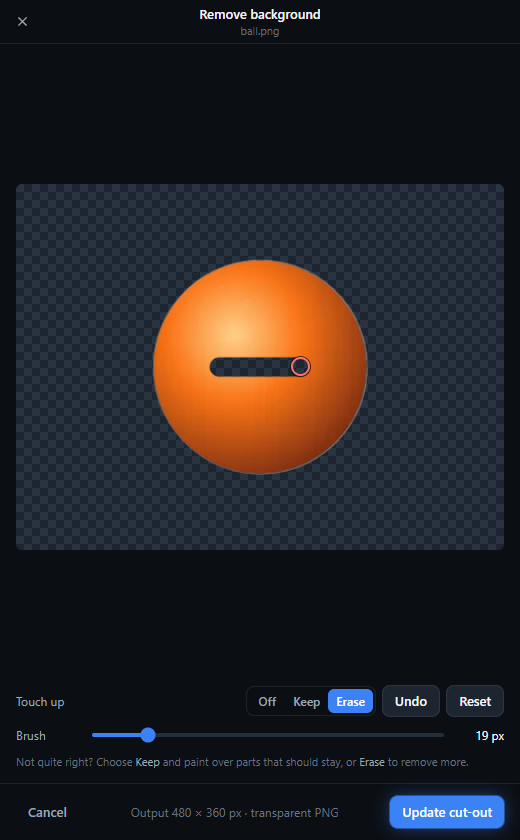
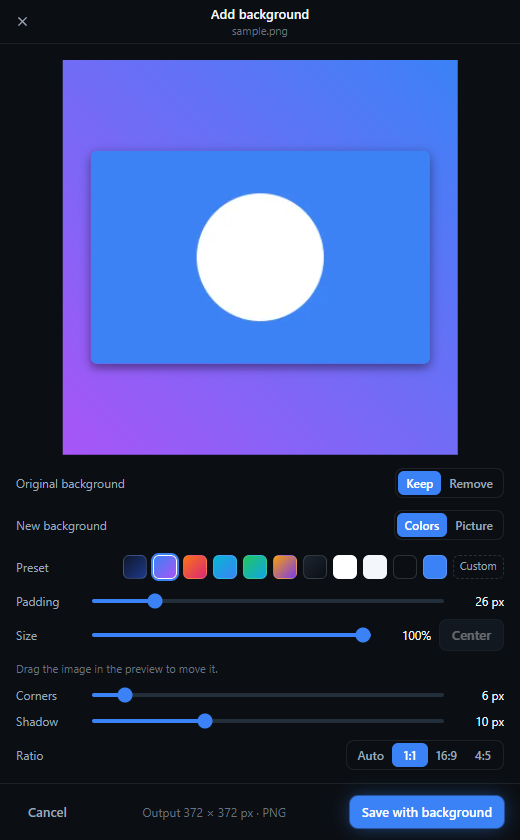
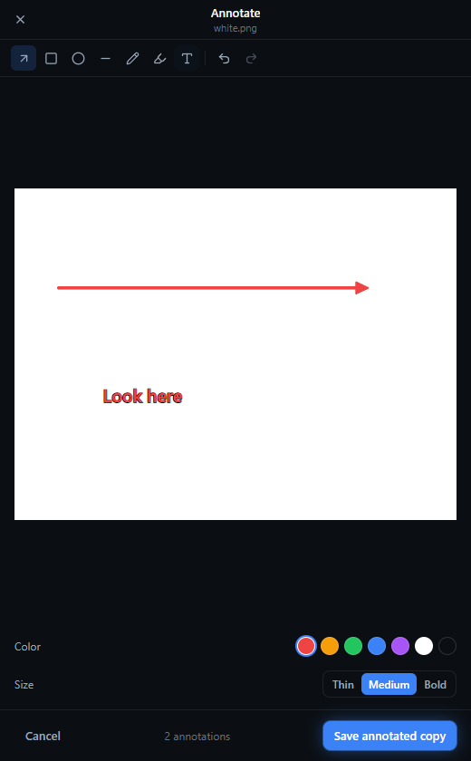
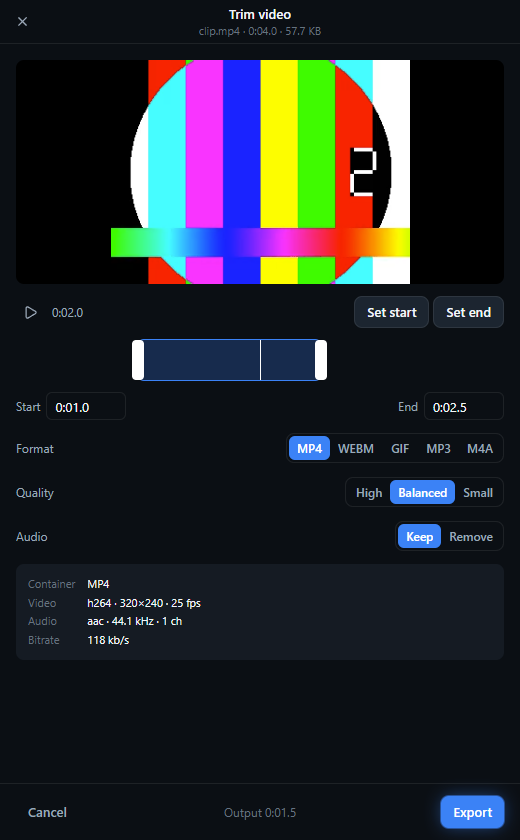
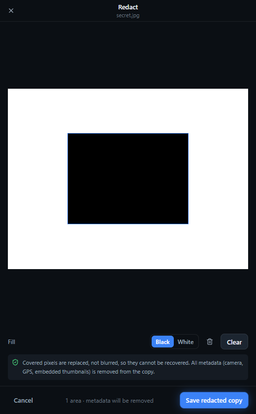

# Twirly


**Drag a file, tap Shift, drop it on what you want.**

<p align="center">
  <a href="brag-output-2026-10-19-114134/brag.mp4">
    
  </a>
  <br>
  <sub>▶ <a href="brag-output-2026-10-19-114134/brag.mp4">Watch the full 25-second trailer</a> (with sound)</sub>
</p>

Twirly is an open-source Windows app that opens a radial action wheel right under your cursor
while you drag files. Convert, crop, annotate, redact or compress them without opening another
program. Everything runs locally: your files never leave your PC.

> ⚠️ **Pre-release (v0.1.0 beta). This is not the final version.**
> It works and is tested, but expect rough edges and changes before 1.0. The installer is not
> code-signed yet, so Windows SmartScreen will warn on first run (More info → Run anyway).


## What it does

- **Drag + Shift anywhere in Explorer** (or a key and apps you choose) → the wheel opens at the cursor. Also works from a drop zone and an "Open with Twirly" right-click entry.
- **The wheel knows what you're holding**:
  - **Images** (PNG, JPG, WEBP, AVIF, TIFF, BMP, HEIC): convert, compress, crop, resize, rotate, annotate, **remove background** (AI, runs on your PC, one or many images at once; a **Touch up** button lets you brush back or erase what it missed), add a background (presets, your own colors or a picture; drag the photo to place it, resize it, optionally cut the subject out first), redact (pixels truly replaced), view/remove metadata and GPS.
  - **PDFs**: to JPG/PNG/TXT/Word (DOCX), merge, split, rotate, compress, extract images, page editor (reorder, rotate, delete, extract, crop).
  - **Word, Excel, PowerPoint**: to PDF (uses your installed Office, or LibreOffice), extract images.
  - **Text files** (.txt, .md, .csv, .json…): to PDF, to Word, combine several into one.
  - **Video & audio**: convert, compress, extract audio, GIF, trim, **shrink for Messenger (25 MB) / Discord (10 MB)**.
  - **Folders & ZIPs**: zip anything, extract ZIPs safely, turn a folder of images into one PDF.
  - **Anything**: copy its path, copy its SHA-256 checksum.
- **Safe by default**: originals are never overwritten; outputs land next to them (`photo-converted.webp`).

## Screenshots

<table>
  <tr>
    <td align="center" width="33%"><br><b>The wheel</b><br><sub>Hover an action, release to run it</sub></td>
    <td align="center" width="33%"><br><b>Remove background</b><br><sub>AI on your PC, then touch up with Keep / Erase</sub></td>
    <td align="center" width="33%"><br><b>Add background</b><br><sub>Presets, your colors or a picture</sub></td>
  </tr>
  <tr>
    <td align="center"><br><b>Annotate</b><br><sub>Arrows, shapes, pen, highlighter, text</sub></td>
    <td align="center"><br><b>Trim video</b><br><sub>Cut, then export MP4, WEBM, GIF, MP3…</sub></td>
    <td align="center"><br><b>Redact</b><br><sub>Pixels replaced, not blurred; metadata stripped</sub></td>
  </tr>
</table>

## Install

Download the latest installer from [Releases](../../releases) (marked **pre-release**). Windows 10/11, x64.

Everything is included: video, audio and HEIC work out of the box (FFmpeg ships inside the installer). Only **Word/Excel/PowerPoint → PDF** needs Microsoft Office or [LibreOffice](https://www.libreoffice.org/). If neither is installed, Twirly offers to install LibreOffice (free) for you the first time you use it, or from Settings → Diagnostics.

## Build from source

```powershell
npm install
npm run helper:build   # needs the .NET 10 SDK
npm run dev            # run in development
npm test               # unit + integration tests
npm run dist           # build the installer into release/
```

Project status, architecture and known issues: [`docs/`](docs/) (start with `docs/progress.md`).

## Credits

- Trailer made with [brag](https://github.com/latent-spaces/brag) and [Hyperframes](https://github.com/heygen-com/hyperframes). Music: "Happy Beats / Business Moves" by [ende.app](https://ende.app). Sound effects: [Kenney](https://kenney.nl) (CC0).
- Built with Electron, React, sharp, pdf.js, pdf-lib and FFmpeg.
- Background removal uses [IS-Net](https://github.com/xuebinqin/DIS) (Apache-2.0, ONNX export from [rembg](https://github.com/danielgatis/rembg)) through [ONNX Runtime](https://onnxruntime.ai) (MIT), bundled in the installer.
- The installer bundles [FFmpeg](https://ffmpeg.org) as separate, unmodified executables under the GNU GPL (licence in `resources/ffmpeg/LICENSE.txt`; build from [BtbN/FFmpeg-Builds](https://github.com/BtbN/FFmpeg-Builds), source at [FFmpeg/FFmpeg](https://github.com/FFmpeg/FFmpeg)).

## License

[MIT](LICENSE). Free to use, modify and share.
